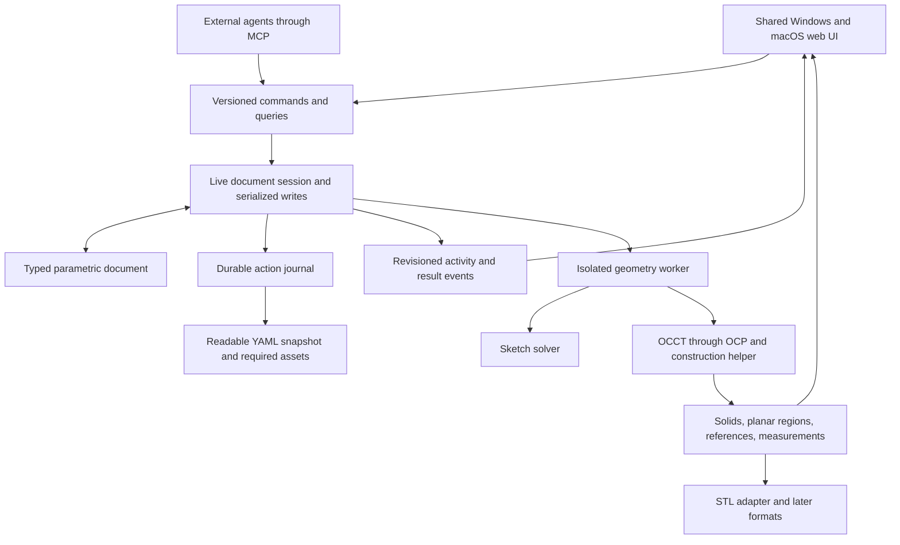

# RyanCAD architecture

**October 28 simplification:** [Simple design intent](SIMPLE_DESIGN_INTENT.md) supersedes the live geometric-reference and automatic named-parameter policies below. Operation-owned snapshots preserve external shape inputs and local frames. Explicit named values are distinguished from private numeric storage slots; legacy records remain readable and migrate on accepted edits.

**Revision 3 — October 24, 2026. Architectural intent. The concrete 0.1 contracts are documented in [API.md](API.md), with gaps tracked in [IMPLEMENTATION_STATUS.md](IMPLEMENTATION_STATUS.md).**

## Browser workspaces and multiple designs

The server keeps workspace metadata beside its configured legacy project, and a separate revisioned project directory for every design. A persistent browser cookie chooses a workspace; the UI sends a per-tab design ID with every CAD request and download so concurrent tabs cannot silently redirect each other's commands. The request-scoped service owns that design's worker, journal, previews, jobs and agent sessions. Workspace defaults are persisted for new tabs. There is no account or authentication model. Workspace recovery codes let a person reconnect from another browser; deletion is recoverable, and a deliberate legacy copy preserves the old journal. See [API.md](API.md) for routing and [USER_GUIDE.md](USER_GUIDE.md) for recovery.

## Unified operation implementation

The [unified workspace](UNIFIED_OPERATIONS.md) uses `operation.create`. `operations.py` owns the strict recipe schema, parameter creation, separate origin/profile/path references, recipe version and native execution. `placements.py` shares exact assembly transforms between evaluation and service queries. Document schema remains 0.2; single-reference operation semantics use `recipe_version: 1`; grouped recipes use version 2, percentage/partial sweep recipes use version 3, and all three remain supported.

The frontend separates draft/default/serialization math (`operationModel.ts`), continuous setup/picking (`OperationPanel.tsx`), serialized debounced proposals and bounded exact-candidate reuse (`useOperationPreview.ts`), and world-projected guides/inputs (`OperationGuide.tsx`). The viewport displays native candidate meshes while retaining original geometry for reference picking. Mouse, drawing and camera state never become authoritative geometry.

`operationRoles.ts` owns the distinct reference colors. `OperationGuide` renders read-only references; every editable quantity lives in its relevant panel section. `Extent along path` uses independent Distance/Percent intent. Native execution resolves percent against current reference arc length and trims exact ordered edge/wire geometry for partial sweeps. Version 3 prevents older evaluators from silently interpreting fractional intent as a full sweep; versions 1/2 retain their old defaults. Display trimming is approximate sampled projection, never authoritative geometry. Source geometry metadata provides native contour loops and revision-local numbered entity labels. The frontend `geometryLabels.ts` separates readable names from guarded references and resolves panel hover onto current native buffers. Panel and viewport hover share a renderer, including safe buffer disposal. Body overlays borrow cached native buffers and own only materials. Hover and label presentation create no commands or document edits.

Same-owner references resolve against the shape entering this feature; cross-owner geometry and relative rigid transforms participate in dependency/cache keys. Semantic references must match uniquely. Implicit sketch planes and placed instances are retained. This is a guarded reference strategy, not a complete persistent-topology naming solution.

Enter requests confirmation of the current draft signature; pending validation/rendering completes before Apply. A later draft edit clears that intent. Escape cancels the whole draft, including picking/drawing. Boolean result and signed travel direction remain independent. Path guides distinguish implicit normals, real selected curves and translated parallel travel. Apply requires the current validated token and rendered mesh, then commits the exact candidate. Confirmed buffers hand off into the committed viewport cache. Export waits for Apply/Cancel; exploded display is disabled during setup and section clipping applies to both geometries. Existing commands, saved features and agents stay compatible. Organization, instance placement and the general constraint editor remain separate activities. Richer sections, path chains, libraries and recipe reopening extend this boundary.

## Placement previews and camera orientation

`MoveComponentPanel.tsx` uses the same revision-checked preview client with command `instance.transform`. Client preview signatures include command name to prevent cross-command cache collisions. The native document/API schema and parent-local rotation/translation semantics are unchanged. Apply commits the exact candidate token; only placement intent/parameters change, with normal durable history/undo. The selected placement is locked for the draft. The panel can begin without a target and acquire one through ordinary selection.

`viewportOperationDisplay.ts` distinguishes material-operation and placement contexts. Placement candidates retain native source mesh buffers and apply the report's flattened world matrices, including parent transforms, patterns and affected descendants. Cancel restores committed matrices; applying restores the newly committed matrices. Linked definitions do not cause unrelated instances to move. Native geometry changes caused by moved references still use the existing concurrent mesh/atomic candidate pipeline. Readiness requires the current proposal to be represented in the scene. Stale proposals remain visible but cannot apply.

`ViewOrientation.tsx` projects unit world-axis vectors through the inverse camera quaternion on each viewport render. It updates SVG attributes directly, without React state updates at frame rate. Translation/zoom do not change the indicator; orbit and named views do. The SVG is presentation-only and lives above the view buttons at the upper right.

## 1. Three layers, one source of design intent

The document describes the design; the engine edits and evaluates it; the UI presents geometry, information, and tools. External agents are additional clients of the same engine.



These are local modules and justified process boundaries, not distributed microservices. The browser contains no authoritative CAD geometry engine. The local Python service works offline on each supported computer.

| Representation | Authority |
|---|---|
| Parametric intent | Components, parameters, tolerance specifications, sketches, features, dependencies, placements and requirements. |
| Action journal plus snapshot | Durable representation of the same document, its accepted revisions, authorship, and undo/checkpoints. |
| Evaluated B-rep / planar geometry | Derived from a revision and engine configuration; includes provenance and validation status. |
| Display buffers | Derived triangles, edges, overlays and pick mappings; never the master design. |
| Measurements | Revision-tagged calculations with scope, units, method and status. |
| Manufacturing exports | Evaluated deliverables; never replace editable native intent. |

## 2. Domain entities and component ownership

| Entity | Responsibility |
|---|---|
| Document | Schema/version, identity, revision, units, tolerance policy, root assembly, parameter scopes, definitions, requirements and assets. |
| Part definition | Owns its parameters, datums, sketches, features and physical output. Kinds include solid part and planar part. |
| Assembly definition | Owns placed child instances and assembly-level intent; has no accidental loose body collection. |
| Instance | References a definition with a stable identity, exact local placement, and an assembly owner. |
| Parameter | Stable ID, readable name, scope/owner, quantity kind, literal or expression, units, optional limits/tolerance and purpose. |
| Datum/frame | Explicit origin, axes, plane or attachment, with its own dependencies. |
| Sketch/curves/regions | Planar geometry, dimensions, constraints, construction flags, boundary loops and holes. |
| Feature | Typed operation, component owner, typed inputs, named outputs, references, suppression and provenance. |
| Fit/requirement | Entities involved, nominal relationship, tolerance convention, expected condition and status. |
| Action | Actor, semantic operation, affected IDs, ordered sequence, base/result revisions, group, timestamps and outcome. |
| Checkpoint | Named durable document revision with required assets and compatible replay metadata. |
| Asset | Content-addressed imported source, type, units decision and provenance; no executable content. |

One solid-part definition produces one connected solid by default. Cavities may have separate boundary shells; that does not imply multiple physical parts. A planar part may have an outer contour and internal holes. Disconnected material islands are separate part components.

The ownership tree and dependency graph are different. Ownership controls organization; dependency edges control evaluation. Enforce acyclic ownership and evaluation graphs. Shared parameter/interface dependencies should be explicit and preferably flow from assembly-level design intent into parts, avoiding fragile face-to-face dependency chains.

Phase 1 supports multiple definitions, repeated instances, assembly grouping, exact placement, and explicit independent copies. Editing a shared definition updates all its instances. Per-instance geometric parameter overrides are deferred to configuration support; initially use a shared definition or an explicit independent definition so instance behavior is unambiguous.

For new geometry, creation commands state an intent: modify active part, new part, new instance, or construction operand. The default for an independent body is a new component. A split operation previews ownership and creates components atomically only when accepted. A parameter edit that changes solid count stops for resolution rather than silently minting new parts.

Construction operands are owned, non-manufactured intermediates. Cross-part Boolean use must specify source/reference semantics and must not consume another part silently. Repeated parts preserve a shared definition; mirrored handed geometry may require a new derived definition rather than pretending a reflection is an ordinary rigid placement.

## 3. Automatic parameters and dependencies

Every editable dimensional input is parameter-backed at acceptance. Store IDs rather than incidental field names or equal-value deduplication. Fixed frame bases, computed vertices, tessellation settings and UI camera values do not become ordinary design parameters.

Creation chooses an explicit existing parameter or creates a new local input with a semantic suggested name, such as “Outer edge radius.” Collision-safe labels and stable IDs avoid mandatory naming dialogs. A user can promote that input to a shared parameter such as “Standard edge fillet,” inspect consumers, and select it for later operations.

Parameter classification is computed from the dependency graph:

- **Independent/root:** literal or constant expression with no design-parameter inputs.
- **Derived:** expression referencing other design inputs.
- **Measured:** read-only output from evaluated geometry, separate from editable inputs.
- **Shared/local:** scope and ownership, independent of root/derived classification.
- **Unused:** no live consumers; deletion still requires checking saved references and history.

Do not feed arbitrary measurements back into their own generating geometry. Later measurement-driven designs require explicit DAG boundaries. Expressions use a small parsed, dimension-aware grammar; no arbitrary Python evaluation. Mixed-unit input is normalized; length plus angle is rejected; counts must be integral.

Provide an indexed parameter table, purpose/category filters, use counts, upstream/downstream lists, and “trace to root inputs.” Selecting a face resolves its producing feature and controlling parameters where possible. Graph diagrams are focused on selection and optional. Users should not have to decipher a huge graph to change a thickness.

Rename preserves IDs. Linking/replacing a parameter previews all affected components, instances and features. “Make independent” creates a new input with provenance. Do not silently link equal numerical values.

Illustrative design-intent fragment, not a finalized valid file:

```yaml
schema_version: "0.2-draft"
document_id: "mold_tool"
revision: 12
parameters:
  p_pin_diameter:
    owner: "assembly_tool"
    name: "Alignment pin diameter"
    kind: "length"
    value: "6"
    unit: "mm"
  p_fit_gap:
    owner: "assembly_tool"
    name: "Alignment diametral clearance"
    kind: "length"
    value: "0.30"
    unit: "mm"
  p_socket_diameter:
    owner: "part_socket_half"
    name: "Alignment socket diameter"
    kind: "length"
    expression:
      operation: "add"
      inputs: ["p_pin_diameter", "p_fit_gap"]
component_definitions:
  assembly_tool:
    kind: "assembly"
    children: ["left_instance", "right_instance"]
  part_pin_half:
    kind: "solid_part"
    feature_sequence: ["left_profile", "left_extrude", "alignment_pins"]
  part_socket_half:
    kind: "solid_part"
    feature_sequence: ["right_profile", "right_extrude", "alignment_sockets"]
```

This omits feature bodies and instance records for readability. The example clearance is a placeholder for testing, not a printer-fit recommendation. Serialized records can live in indexed tables, but every scoped entity identifies its owner.

## 4. Precision and tolerance contract

Separate explicit location from constrained intent. A sketch can have definite coordinates while retaining degrees of freedom. Show remaining freedom, redundant constraints and conflicts; preserve solution seeds and surface branch ambiguity. Simple parameterized constructors should avoid an unnecessary constraint-solving burden.

| Quantity | Meaning |
|---|---|
| Nominal dimension | Intended geometry, e.g. pin diameter. |
| Fit clearance | Intended difference, explicitly radial/per-side or diametral/total. |
| Engineering tolerance | Permitted departure from nominal; symmetric, asymmetric limits, or explicitly unspecified. |
| Process allowance | Intentional compensation for a stated fabrication process; separate from nominal geometry. |
| Kernel / solver tolerance | Numerical calculation policy, not a manufacturing guarantee. |
| Tessellation tolerance | Approximation budget for display/export. |
| Display rounding | Presentation only; never modifies the geometry. |

The inspector shows nominal value and engineering tolerance together. Document defaults can supply tolerance values, but inheritance is visible and unspecified is never treated as zero. Store tolerance values with units and provenance, not merely formatted text.

For basic pin/socket fits, expose nominal diametral clearance and the worst-case interval computed from socket/pin limits. Report assumptions about independent manufacturing deviations. Account for shared root expressions when propagating design intervals; avoid double-counting the same uncertain input. General statistical stack-up and GD&T analysis are deferred.

Report valid geometry, nominal fit, tolerance-envelope fit and measured printed fit as separate results. Confirm printed fits through calibration coupons/measurement before claiming physical success. Mold demolding, silicone behavior and concrete shrinkage are not inferred from a green geometric badge.

## 5. Persistence and autosave

A readable snapshot alone is a poor write target for every tiny edit. Proposed native working project: a folder containing a YAML manifest, a SQLite edit journal, required assets and named checkpoints. A portable native archive is a materialized snapshot for transfer/backup. It is separate from manufacturing export.

The logical source of truth is **snapshot at revision N plus committed journal entries after N**. These are not independently editable masters. Manifest/journal revision identifiers and checksums prevent mismatched recovery. A human-readable snapshot may lag briefly; the live document is reconstructed from the journal.

Proposed policy, to calibrate during the persistence milestone:

1. Stage edits and validate intent/geometry off the UI thread.
2. Append each accepted semantic action, document change, authorship and resulting revision in one atomic durable transaction.
3. Group disk flushes for rapid edits with a target maximum delay of 100 ms and a hard proposed cap of 250 ms under normal operation. Preserve individual action records and order.
4. Acknowledge “saved” or successful durable MCP commit only after persistence completes. Earlier UI output is a marked preview/pending revision, not a durable success.
5. Materialize the YAML snapshot after 500 ms of quiet, with a maximum 2-second interval during continuous edits. These delays never postpone durable journal persistence.
6. Flush on normal close, explicit Save now, checkpoint, export and portable snapshot creation. UI loss does not discard edits already acknowledged as saved.

Use a serialized persistence writer, revision checks and bounded backpressure. A disk failure preserves the last durable state, reports failure visibly, and pauses further committed writes rather than accumulating invisible unsaved work indefinitely. Pending edits can be recovered or exported to another location. Record incomplete drafts explicitly without presenting invalid geometry as validated.

SQLite supports transactional storage through Python's standard-library interface. Durability settings must be chosen and tested explicitly; do not assume a fast default mode provides power-loss durability. [Python sqlite3](https://docs.python.org/3/library/sqlite3.html), [SQLite synchronous policy](https://www.sqlite.org/pragma.html#pragma_synchronous)

Snapshot updates use temp-write, flush, atomic replacement where supported, and retention of a previous known-good snapshot. Mark the covered journal revision before pruning; never prune actions needed for recovery, undo or retained checkpoints. Keep a bounded active replay tail while preserving the activity history needed by the UI.

Crash tests must cover interruptions before/after journal commit, during snapshot replacement, during compaction and after tool acknowledgment. Distinguish application crash tests from power-loss guarantees dependent on OS/filesystem/hardware behavior.

Autosave is local persistence, not cross-device synchronization. Do not treat OneDrive or a shared folder as a live multiwriter database. Prefer active local projects and explicit consistent snapshots for transfer; detect conflicting writers and external modifications. Never instruct users to copy only an in-use database or manifest. Export a consistent native archive through the application.

Restricted YAML allows only JSON-compatible values, string keys, bounded size/depth, unique keys, and no executable tags/aliases/merge keys. Validate schemas before creating domain objects. Packages reject traversal paths, duplicate entries, excessive expansion and missing assets. Required imported assets are portable; disposable geometry caches are not authoritative. Credentials and machine-local UI preferences stay outside the design.

## 6. One live document session for humans and agents

A process-local document service owns each open document and serializes writes. Browser UI, MCP adapter and headless clients attach to its session/document ID. An MCP connection must not create a hidden parallel copy of the file.

Commands carry actor/session context, expected revision, idempotency key, semantic arguments, units, target IDs and optional action-group ID. Results identify durable revision, changed entities, validation state and available geometry. Long jobs return pending job IDs; completion/status queries distinguish pending from committed.

Recheck the base revision and the actor's current write capability at commit, not only when starting a job. Pause/revoke can invalidate a staged result; it cannot erase an edit already durably committed. Session-control requests remain responsive while the geometry worker is busy.

Events carry monotonic sequence numbers, revision, actor, operation, affected entities, evaluation status, saving status and result references. The UI receives these through its application event channel; MCP is the agent command transport, not the UI rendering bus. Reconnecting clients request events after their last sequence or receive a consistent snapshot.

MCP exposes schema-described tools and standard transports, but it does not supply CAD timelines, author attribution or viewport updates automatically. Those are application responsibilities. [MCP tools](https://modelcontextprotocol.io/specification/2026-07-28/server/tools), [MCP transports](https://modelcontextprotocol.io/specification/2026-07-28/basic/transports)

Start with a local stdio MCP adapter that connects to the running service. Bootstrap must discover or start the same service predictably. Use loopback-only authenticated application endpoints, origin checks, and project-scoped capabilities; remote hosting is deferred.

Actor provenance includes local user/connection identity, human/agent kind, display name, client/session, command and optional supplied task label. Identity comes from the service's authenticated context; a client-supplied display name is labeled as such, not treated as verified identity. Preserve created-by and later modified-by attribution; imported assets have their own provenance.

No model provider or credentials are needed inside the application. Do not log private reasoning, unrelated agent conversation or secrets. Store visible CAD actions and useful supplied descriptions.

## 7. Observable actions, history and control

| Mechanism | Behavior |
|---|---|
| Feature timeline | Construction dependencies, edit/suppress, component filtering and valid ordering. |
| Activity overlay | Ordered human/agent actions, including edits to existing parameters/features; actors and outcomes. |
| Feature rollback | Evaluate a dependency-complete earlier construction state with current parameter values. |
| Undo/redo | Reverse/reapply transactions without erasing the audit record. |
| Checkpoint | Restore actual earlier document intent and parameter values. |
| Session controls | Follow activity, inspect selection, step dispatch, pause/revoke agent writes, cancel work. |

Keep feature history and action history linked, not conflated. An agent editing a radius updates the existing feature and adds an attributed action event. It does not need to append a fake new modeling feature.

Default agent operation is one meaningful command per committed visible step. Fast mode may skip intermediate display frames but must retain every action; the user can inspect those states afterward. Step mode gates dispatch until Continue. Pause prevents the next mutation and requests cancellation of the active job; already durable edits remain. Revoke invalidates queued commands and tokens. Do not force the human camera to follow.

Explicit atomic batches preserve step descriptions and staged previews. They commit together or not at all; rejected previews are not falsely represented as successful history. Ordinary sequential agent sessions must not hide all work inside one giant batch. Grouping actions visually does not change undo boundaries unless requested.

Undo the latest transaction by default. “Undo this agent's whole run” is straightforward only if its edits form the current contiguous tail; interleaved human edits require an impact preview or restoration from a checkpoint, never indiscriminate deletion.

Across components, a rollback cursor selects a dependency-closed state. If a selected part needs an upstream datum or shared feature, include it or explain why evaluation cannot proceed. Do not combine arbitrary histories into a physically inconsistent assembly.

## 8. Expensive operations and geometry workers

The UI owns rendering, camera and local selection feedback. Geometry work runs in a separately supervised native worker; do not assume wrapper thread safety or that a Python thread can stop a stuck kernel call.

Record per-feature/operation elapsed time, affected geometry size, cache state and engine signature. Distinguish last measured time from predicted recomputation cost. Navigation cost reflects the requested dependency path, not just one highlighted feature. Unknown cost gets an unknown label.

Proposed threshold: uncached paths previously above 500 ms, or predicted expensive/unknown complex paths, show a cost badge and require an explicit Compute action during history navigation. Cached snapshots display immediately. Scrubbing coalesces transient requests and does not start each rebuild. A global preference can relax prompts; heavy work never moves onto the UI thread.

Cancellation may require killing/restarting a worker after a grace period. Preserve the durable model, discard staged results, and reject any late response whose revision/job generation no longer matches. Keep progress honest when a kernel offers no meaningful percentage.

Cache dependencies include operation implementation, kernel/solver version, normalized parameters, geometry inputs, frame, tolerance policy and parameter context. Recompute affected nodes only. Cross-version bit-identical meshes are not promised.

## 9. Stable references and direct edits

Prefer root datums, named sketch entities, semantic feature outputs and kernel lineage over geometric guesswork. Faces can split, merge or disappear, so UUIDs or triangle indices alone do not solve persistence. OCCT naming requires tracked modeling history and selection recomputation. [OCCT OCAF guide](https://www.occt3d.com/dev/doc/overview/html/occt_user_guides__ocaf.html)

A reference includes owning definition/instance context, source feature, semantic role, expected type and lineage. Guarded geometric matching may offer repair candidates; zero or multiple matches are explicit failures. Never silently select a nearby face.

Face push/pull edits a generating parameter when unambiguous, showing its other consumers. Otherwise use a documented supported offset feature. Planarity alone does not guarantee validity. Arbitrary edge deformation, unrestricted surfacing and automatic topology repair are outside Phase 1.

## 10. Measurement and assembly semantics

Metrics include scope, revision, units, method and current/calculating/stale/unavailable/estimated state. Show per-instance and per-definition information distinctly. Count linked instances once each for assembly quantities, not once per unique definition. Suppressed/non-manufactured construction entities do not contribute; visibility alone does not affect totals.

For a disjoint collection, total material volume is the sum of manufactured instance volumes. Overlaps are reported; do not silently replace quantity-based volume with a Boolean-union volume. Geometry centroid and mass center are different.

Prepare a material/property attachment and quantity-aware cost evaluator boundary for Phase 2. Cost changes require explicit units, price basis, density or process assumptions, and included instances. Volume alone does not determine actual printed material consumption, support, waste, silicone usage or machining cost.

Phase 1 implements targeted nominal fit distances, section inspection and interference checks for the reference mold. Exhaustive collision detection during demolding, strength analysis and printer-specific feasibility are not implied.

### Contextual viewport information

The view's information policy is a separate analysis boundary described in [CONTEXTUAL_INFORMATION.md](CONTEXTUAL_INFORMATION.md). The current renderer-independent `MeasurementService` accepts measured candidate geometry, focus/recent-interest state, and projection/visibility callbacks, then returns ranked candidates, score contributions, and placements. React/Three.js only adapt live view state and render the result. Provider and signal registries support future information types without per-tool annotation code.

Keep attention memory, layout, and candidate selection transient. They are not native CAD features and do not produce autosave/history commands. Values come from evaluated geometry metadata; projection coordinates are never used as physical measurements. Future read-only agent/UI contracts should expose scope/revision, source, quantity type, units, assumptions, confidence, and reasons, without granting a display policy authority to edit the document.

## 11. STL now; other formats through adapters

Export a selected physical component instance, a selected definition in its local frame, or a batch of separate files. Default batch output is one STL per selected manufactured instance with stable collision-safe names and a receipt mapping files to component IDs, revisions, frames, unit convention and tessellation settings.

Each exported solid part must validate as one connected solid. Multiple disconnected components in the document are normal. Do not reject an assembly merely because it contains separate parts, and do not silently union them to produce an STL. Aggregate multi-part STL is deferred; per-part batch output is sufficient for Phase 1.

Check B-rep validity, intent postconditions, mesh closure/manifoldness, winding, degenerate facets, self-intersection within documented coverage, units and dimensional fidelity. Preserve valid cavity shells. Choose local-part or assembly placement explicitly. Native planar parts need an explicit solid/thickness conversion before STL export.

STL has no standard physical-unit field; default output convention is millimeters and is shown in the receipt. Finer tessellation costs more and is limited by shape tolerance. [STL format](https://www.fabbers.com/tech/STL_Format), [OCCT mesh guide](https://occt3d.com/dev/doc/overview/html/occt_user_guides__mesh.html)

The format-adapter contract declares direction, capabilities, units, retained/lost semantics, supported entity kinds and approximation. Native history recovery is never implied by importing a mesh.

3MF can represent mesh objects, units, component references/transforms and material information. Its standard manufacturing model is not our parametric feature/constraint/action model. Keep it a future adapter; private extension data would still require RyanCAD semantics and would not make those semantics universally editable. [3MF core specification](https://github.com/3MFConsortium/spec_core/blob/master/3MF%20Core%20Specification.md)

## 12. Integrated planar manufacturing

Use the same component tree, parameter model, frames, selections, commands, history and tolerance inspector for planar and solid parts. Planar focus can align the camera orthographically without switching products or hiding the assembly.

Separate curves, closed wires, filled regions with holes, and manufacturing operations such as cut/engrave. A sheet-thickness preview is derived; an explicit extrusion creates solid geometry. Converting the same part retains identity where meaningful and must not double-count a preview and its physical output.

Future SVG handles physical dimensions, viewBox/transforms, Y-axis conventions, fill rules and curve approximation. Preserve analytic curves where possible. SVG strokes are not automatically material boundaries; stroke outlining is explicit. Disable scripts/external resources and report unsupported content. [SVG coordinates](https://www.w3.org/TR/SVG2/coords.html), [SVG paths](https://www.w3.org/TR/SVG2/paths.html)

Kerf and process allowances belong to fabrication settings, with direction, units and provenance. Do not bake them invisibly into nominal dimensions. Phase 1 supplies the shared model and interaction foundation; SVG interchange and fabrication compensation arrive when requested.


## Implicit tools and fast previews

`inferOperationSelection` maps geometry types into draft updates independently of scroll position; explicit picking and drawing roles take priority. Source geometry never implicitly changes the target. Manual result choices and pinned origins survive inference. Unsupported replacements invalidate the candidate.

Native Auto computes overlap against the specified target, returns its decision, and is resolved by the service into fixed Add/Remove intent before a preview can commit. Selection metrics are provenance; they do not silently re-run the classification during parameter regeneration. Native decision caches follow the same feature-geometry keys and bounds as shape caches.

The preview client uses 120 ms quiet time, an immediate Enter flush, one in-flight computation, 35 ms job polling and six revision/argument-keyed proposals with 60 s reuse. Stale meshes remain explicitly marked and cannot apply. Reference changes do not refetch unchanged preview buffers; changed meshes load concurrently. Expired tokens trigger revalidation and require another confirmation. The native model and tessellation accuracy are unchanged.


## Measurement scope in the workspace

`inspectorMeasurements.ts` is a display-only projection over native geometry and placed instances. One selected physical component reports one definition's geometry; a selected assembly reports its placed descendant subtree; no selection reports all unsuppressed physical occurrences, including hidden and linked uses. Historical geometry can be supplied without substituting current geometry for missing history. Planar parts have no invented solid volume and unfinished parts produce explicit availability/partial-total indicators. The inspector owns these measurements; the structure tree owns counts and the timeline owns revision/Undo/Redo. No document or engine schema changed for this layout. Viewport overlays reserve the relocated navigation/selection controls rather than an obsolete statistics strip.

### Tool viewport presentation

`viewportOperationDisplay.ts` separates operation focus and retained candidate presentation from native reference-picking geometry. Selection overlays have their own lifetime; selection changes do not reconstruct source meshes. Preview loads prepare a replacement group off-scene and swap it atomically, masking source color/depth drawing for replaced occurrences while keeping raycasting intact. Candidates stay opaque and match component colors; inactive context components become transparent by definition ownership. Pending/invalid drafts use textual stale status, with confirmation gated by the latest displayed token. Linked candidate assets are released once per asset map. Face highlights copy their own positions so their disposal cannot invalidate the native part buffer.

The continuous tool form and inspector share layout width variables at every breakpoint. Tool Origin/Profile/Path/Effect are user-facing section names; recipe keys and schema version remain compatible.

### Grouped references

`groupedSelection.ts` owns entity identity, homogeneous Shift toggles, canonical role membership, placed-edge connectivity and profile-plane prevalidation. `operationModel.ts` stores complete grouped references alongside compatible primary references. Origin following is independent of role updates; choosing a path does not relocate a face anchor. The viewport renders independent overlays for every selected reference without rebuilding native parts.

`operation_selection.py` validates native connected wires and parallel regions. Version-2 recipes store bounded `path_references` / `profile_references` in feature references; each source's current native shape/profile and occurrence matrix participate in the cache stamp. A shared translation preserves relative profile placement, each profile builds its own native tool with the common motion, and tools are fused before Auto/Boolean processing. Guarded coplanar face disambiguation is shared by picking metadata and native resolution. Component deletion scans nested references. Existing single-reference recipes remain unchanged in meaning.


### Component movement methods

`instance.move` is a native, previewable command separate from absolute `instance.transform`. `movement.py` resolves local point/direction snapshots against flattened saved occurrence matrices. It computes world displacement then converts through `occurrence_world × inverse(source_local)` so nested parents and circular-pattern member frames are respected. Directional alignment uses a normalized dot-product projection; orientations are unchanged outside the XYZ increment method. Expressions use the dimensional parameter evaluator, with named movement inputs and independent result placements so a shared prior placement parameter is not overwritten. Reference snapshots remain in the authored command record; they do not become persistent joints.

`MoveComponentPanel` owns method, pick role, reference anchors, distances and confirmation intent. App forwards viewport/tree picks to the panel without retargeting. `MovementGuide` projects native source/destination/target/direction data and partial picked references with the active camera each frame. Mint displacement, amber source, blue target and violet direction provide separate visual roles; constrained moves also show the leftover gap. The common preview hook still serializes work, rejects stale responses, and commits only a displayed validated token.


### Inferred reference movement and axis-angle placement

`movementModel.inferMovePick` is the shared client selection policy: whole component → moved component; unarmed straight edge → direction; point/face on active occurrence → origin; outside point/face → target. Explicit component/origin/target/direction arming overrides the policy for one successful pick. Retargeting resets stale references/inputs. `movementArgs` serializes only the selected method's relevant fields. Reference motion is inferred in the native reducer as well, so external agents have the same exact-distance precedence and default-origin behavior as the UI.

The native placement map supports an optional parameter-backed axis-angle delta (`rotation_angle`, `rotation_axis_*`, `rotation_origin_*`) over its base Euler placement. `placements.local_matrix` evaluates Rodrigues rotation around the actual parent-frame axis line. Keeping the angle native avoids lossy frozen Euler angle results and supports later parameter edits. `bake_rotation` and gimbal-safe `matrix_pose` snapshot the evaluated starting pose when another placement command follows. All existing geometry, measures, exports and flattened occurrence frames use this shared matrix path. The document schema remains a readable parameter-backed placement map.

`MovementGuide` renders a camera-projected rotation arc around the selected line, plus axis and angle, while reference movement uses source/target/direction/displacement/gap roles. The fixed footer owns result measurements. Incomplete reference drafts clear old previews; explicit reference and component clear controls re-infer without starting a new operation.


### Midpoint references, global axes and automatic movement distance

Move viewport picking adds exact native edge midpoint candidates alongside topological vertices, with the existing screen-space tolerance and occlusion checks. A midpoint is a display point bound to its edge (`vertex.anchor=mid`); labeling and display-reference resolution distinguish it from topological vertices. In reference movement it infers origin/target; rotation and explicit direction picking normalize it back to its underlying straight edge. Hovering an edge exposes its midpoint marker. Material-operation edge selection keeps its established behavior.

Global direction references serialize as `{axis: X|Y|Z}`. The native reducer resolves them without an occurrence transform and uses the world-origin line for rotation. The movement panel provides explicit X/Y/Z controls, and the enlarged camera indicator routes axis gestures to Move or the active material operation. Axis requests made before component acquisition are retained until the component is chosen. The indicator shares selected-axis state with the draft; its visible and hit-test segments both follow camera projection.

`inferredMovementDistance` computes the displayed automatic value from saved reference frames. It uses a signed dot product when a direction is selected and point distance otherwise. The panel keeps that derived value separate from `values.distance`; only manual edits create exact overrides, and Use inferred distance clears them. Thus the field prepopulates without changing command signatures, freezing target motion or recursively triggering previews.

Movement reference controls reuse the operation reference-card/pick-slot styling with amber origin (#ffc281), blue target (#a5caff), and violet direction/axis (#b4a0ff), matching the viewport guide. Role icons, pointer affordances, keyboard focus highlighting, clear controls and matching active-pick borders keep panel and model relationships explicit.


### Native target extents and exact corner cross sections

Operation recipe v4 adds a semantic travel-target reference and true full finite linear/axial travel. `prepare` resolves world-origin references directly and includes target geometry/placement in the feature cache stamp. `execute` projects targets into owner-local travel frames; sweep targets use closest points on the translated native wire followed by native arc-length parameterization. Legacy recipe behavior remains unchanged. Multiple parallel profiles use one shared target-derived travel extent, preserving their relative positions.

`operation_display.py` derives finish profiles by sectioning the source and result solids at an interior station perpendicular to the primary edge, subtracting the planar regions, and returning the nearest changed region with exact area and native curved boundary sampling. This captures arbitrary corner angles and concave added material as well as ordinary removed corners. Only one primary section is computed per feature to bound preview cost. The metadata is cached beside shape evaluation and forwarded in the preview report; `operationFrame` renders those exact world loops rather than its former square sketch. Invalid/unavailable sections remain empty rather than inventing geometry.

A target-limited straight finish clips native source/result difference solids with an exact finite slab. It keeps the kernel's corner form inside the requested segment and explicit planar end caps. Curved/multiple-edge partial finishing is guarded, not approximated. Viewport travel and target guides use evaluated endpoints. Face-to-path expansion uses native `edge_signatures`, never matching tessellated outlines or nearby edges.


## Main-viewport design sketches

`sketchModel.ts` defines a shared editable sketch draft, explicit orthonormal frame, entity transitions, snapping and copied projections. `SketchPanel` supplies the fixed-width operation form, local undo and constraint inputs; `SketchGuide` renders an adaptive grid, U/V axes, current geometry, cursor and size labels over the native viewport. The same WebGL component meshes remain reference pick targets with muted materials. Viewport camera state is captured once on entry, realigned on plane changes and restored on exit; pan and zoom remain available, orbit is disabled except during plane acquisition.

App retains a pending material OperationPanel mounted but hidden with native preview generation suspended while the shared sketch session runs. Finish creates or updates one authored sketch, attaches its stable feature reference and resumes the tool. Cancel leaves its original draft intact. Sketch geometry uses root ownership by default and is rendered in a separate saved-sketch layer; it does not become an occurrence or body/export quantity. Legacy physical-component ownership remains valid and its first matching occurrence provides the editing display transform.

The evaluator registers root sketches independently before evaluating bodies; root resolution returns assembly/no shape after registering profiles. Each sketch has its own native cache key and solver result. Nested loops form holes/islands; disjoint regions remain construction profiles. Unified tools currently require one closed region per sketch. Explicit frozen frame placement and independent sampled projections are intentional current limits; there is no associative face attachment/projection or continuous live solver yet. See SKETCH_WORKSPACE.md.


## Group ownership and selection scope

`groups.py` implements atomic assembly-backed grouping/add/copy/ungroup commands over the existing instance model. Identity insertion preserves member placement expressions. Transformed additions/ungrouping compose exact matrices, rebase into fresh placement parameters and retain existing parameter identities. Occurrence path remapping follows semantic modeling references through organization changes. Group copying recursively creates independent assembly definitions/instances while physical component definitions remain linked.

`groupModel.ts` resolves viewport hits to the immediate closed object in the active edit scope and expands group highlights into physical descendants. `GroupPanel` handles explicit membership selection. App owns the edit-scope breadcrumb/tree and routes double-click to entry and Done/Escape to exit. Native part picking meshes remain available for in-group feature editing and movement references; viewport group movement uses existing retained transform previews. See GROUPS.md for limits.
