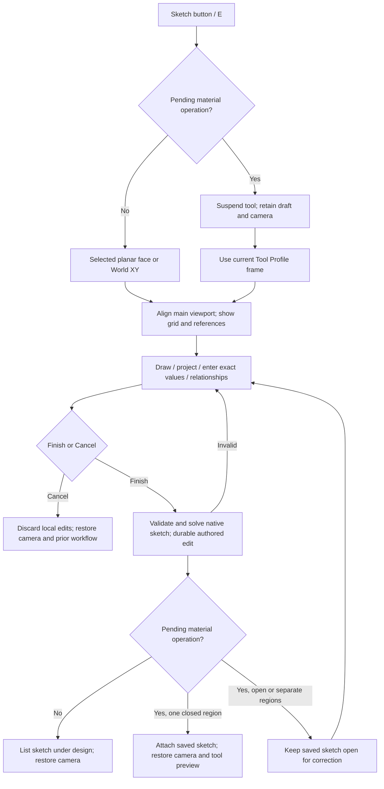

# Sketch workspace

Sketch (E) uses the normal viewport and fixed-width operation side panel. `SketchEditor.tsx` and its independent modal canvas have been removed. There is one sketch session implementation for direct design drawing, editing an existing sketch, and creating an ad hoc material-tool profile.

## Drawing interactions

| Action | Input |
|---|---|
| Line | First point, then connected endpoints; End chain stops the sequence |
| Rectangle | Opposite corners; creates four editable connected lines |
| Circle | Center and point on radius |
| Center arc | Center, start, end; counterclockwise |
| Point | One click or exact U/V pair |
| Select | Pick an existing entity or choose its ID in the panel |
| Project | Pick a body edge, vertex, or face boundary |
| Exact placement | Enter U/V in mm, then Place exact point; bypass grid rounding |
| Pan / zoom | Right/middle drag / wheel; sketch rotation is locked |
| Pick plane | Temporarily allow orbit/standard views, then select a planar face |
| Escape | Stop plane picking, otherwise end a partial drawing action, otherwise cancel sketch |
| Enter | Finish current sketch |

Grid spacing follows zoom. Grid snap is independently configurable and may be disabled. A screen-space tolerance prefers existing endpoints, midpoints, centers and the origin; lines also align with their start U/V. Exact coordinates/radii and selected-entity construction/fixed state are editable. Local undo covers geometry and relationship edits; model undo remains outside the session.

The panel exposes native relationship types, reference IDs and dimension values. Adding a relationship frees participating fixed geometry; Finish runs PlaneGCS and preserves conflicts as actionable errors in the editor. Existing relationships can be edited or removed. The session is not continuously solved, and there are no draggable dimension handles yet.

## Ownership, geometry and persistence

- New sketches have `owner: root` and independent feature/parameter identities. They create no component or instance and contribute no material quantity or STL geometry.
- Root sketch evaluation resets physical accumulation for each sketch, registers each profile separately, and precedes body evaluation. Downstream operations depend on the sketch profile cache key.
- Existing component-owned sketches remain supported. The UI places their local frame using the first matching occurrence when displaying/editing; there is no automatic ownership migration or ambiguous choice of a different linked occurrence.
- World planes or explicit orthonormal origin/U/normal frames define placement. Picked planes are frozen world frames in this pass; they do not follow subsequent face movement.
- Open sketches, construction points and disconnected closed regions can be saved. Native closed wires are nested into faces/holes; the initial unified tool still accepts one closed region per selected sketch.
- Projection creates independent fixed construction copies. Native display samples are transformed through occurrence placement and projected into U/V; curved copies are sampled lines, not exact associative curves.
- Finish commits one authored sketch action. Draft points are local until Finish; Cancel does not save them. An ad hoc sketch that has already been explicitly finished but cannot yet serve as a closed tool profile remains saved and editable.
- Sketch visibility in the tree is session display state. Saving/reopening preserves sketch geometry, relationships, world frame and downstream references.

## Frontend boundaries

`sketchModel.ts` contains plane frames, entity geometry, snapping, click transitions, projection and model hydration. `SketchPanel.tsx` owns drawing controls and local edit undo. `SketchGuide.tsx` draws the grid/entities/cursor in an SVG overlay over the existing WebGL viewport. Components retain their native picking meshes and are muted during drawing. `Viewport.tsx` raycasts into the sketch plane, locks orbit and captures/restores the camera position, target, up, zoom and frustum. Its saved sketch layer remains visible outside editing and participates in Fit when no bodies exist.

`App.tsx` owns the session, root sketch tree and shared entry/return flow. A pending `OperationPanel` remains mounted but hidden and suspended, so its draft survives. No native solid preview is retained during sketching. Completing the sketch attaches its stable feature reference, adopts the drawn profile center as Tool Origin and clears already-baked origin offsets so world placement is preserved, then resumes evaluation; cancelling restores the original draft.

## Follow-up decisions

1. Should clicked faces and projected references stay associative, with explicit repair when a source changes, or remain frozen copies unless linking is requested?
2. Should new geometry default to exact fixed coordinates or infer editable constraints/dimensions? Live solving and visible DOF/conflict markers should accompany that choice.
3. Prioritize direct on-canvas dimension editing, trim/extend, offset, sketch fillet, mirror/pattern, or richer region selection next.
4. Decide whether one sketch may supply several regions to one tool, and how users choose among nested/overlapping regions.
5. Decide how legacy component sketches migrate to root ownership, how linked-instance placement is chosen, and whether sketch visibility/grouping belongs in the saved document.

## Sketch toolbar and reference picking (October 28)

Sketch editing replaces the modeling toolbar with Select (V), Line (L), Rectangle (R), Circle (C), Center arc (A), Point (P), and Project (J), plus sketch Undo (Ctrl Z), Finish and Cancel. Changing tools ends an unfinished chain without discarding existing geometry. Shortcuts are inactive while entering text or numbers and while choosing the sketch plane. The sidebar holds the plane, drawing settings, numeric coordinates, geometry properties and constraints.

Endpoints use small circles; edge midpoints use diamonds. Arc endpoints/midpoints and curve centers are also shown. Select a marker with Select to inspect its exact U/V reference coordinates and parent geometry. Markers remain the same size on screen while zooming. Midpoints are derived references, not new sketch entities or automatically added solver constraints.

Snapping prefers nearby vertices, midpoints and centers, then exact existing line/curve geometry, before grid rounding. Its tolerance follows screen pixels. The viewport Snap on/off button (S) disables grid snapping without disabling geometry snapping or erasing the configured grid spacing. Grid visibility remains independent.

Saved sketches can be selected by clicking their visible geometry in the main viewport or their sidebar row. Both clear stale component selection. Press T or click Tool to use the selected sketch as the operation profile; without an active component this starts New component, with no guessed distance. An existing pending operation can also acquire a sketch by viewport selection, preserving its target and effect. Open/non-manufacturable sketches remain selectable but must form a valid closed region before a solid preview can validate.

## Line dimensions

Choose Dimension in the sketch toolbar or press D, then click a line. Enter a positive length, a length parameter name, or a supported expression and press Enter or Set dimension. The line is freed from fixed coordinates, and an endpoint-distance constraint is added or edited. The viewport input solves the sketch as you type. Invalid values leave the last valid preview visible; Enter accepts it and Escape restores the previous sketch. Finish sketch validates and saves the edit, including downstream geometry. Reopen the sketch and use Dimension on the line again to edit the dimension. Named parameter references remain linked when the parameter changes.

Constrained lengths and angle constraints are drawn in mint with dimension lines/arcs. Subdued measurements of unconstrained line lengths and joined angles are informational. These measurements do not add constraints. Existing drawing tools do not automatically constrain coincident endpoints: lines that only touch visually may separate when a dimension changes. Add coincident relationships where the connection must be maintained; conflicting fixed coordinates may need to be freed.

In the sketch editor, Shift + right-drag orbits around the sketch while keeping the camera on the front side of the sketch plane. Rotation gradually slows toward its 70-degree limit. Right-drag pans, and Align view restores the face-on view. The previous modeling view is restored on leaving the sketch.
