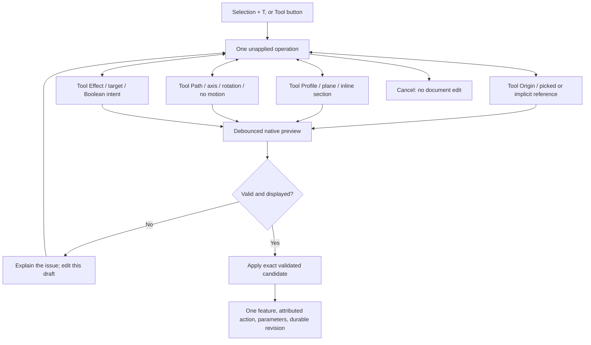

# One tool, a continuous modeling workspace

**October 29, 2026 — implemented development workflow.** This document records the owner's unified-operation direction, its current behavior, and the next steps. It supplements the [product request](PRODUCT_REQUEST.md), [user guide](USER_GUIDE.md), and [API contract](API.md).

## The interaction contract

Round and bevel are generated-profile presets in this same operation model. Their default Tool Effect is Remove material, their Tool Path is the normal selected-edge sweep, and their reference card contains the temporary profile, its real cross-sectional outline and area. The viewport and card consume the same native-derived profile data. Radius/bevel size regenerates it. The effect selector remains functional: Remove applies the removed tool volume, Add supports concave material-adding profiles, Intersect keeps overlap, and Auto infers the applicable side. An incompatible effect reports no geometry change rather than silently performing another effect. These generated profiles currently follow model edges; other motion choices and New component are unavailable for this preset. Change the profile within the same workspace to use other configurations. Existing saved corner operations retain their previous geometry and adopt explicit effects when edited.

Press **T**, or click **Tool**, with geometry selected or with no selection. A dock replaces the right inspector, leaving the model visible and navigable. The dock and inspector have the same width at each supported window size, so switching between them does not resize the viewport. It contains four persistent sections in one scrolling form:

1. **Tool Effect:** whether to create, add, remove, or keep an intersection.
2. **Tool Profile:** the section, face, existing sketch, corner treatment, or solid tool.
3. **Tool Path:** how that profile becomes geometry, including no motion.
4. **Tool Origin:** the picked or implicit reference that anchors the operation.

All four sections remain mounted. Scroll between them without changing stages or losing entered values. The dock initially scrolls to the most relevant section: Tool Profile for edge/primitive starts, Tool Path for face/sketch starts. Each section places its type selector above the colored reference box, which groups the named reference, count/status and removable selections. **Tool Origin** always uses an implicit or picked reference and follows Tool Path in the panel. Origin offset inputs are omitted from this basic layout; existing stored placements remain unchanged. There is no origin-type switch or panel world-origin shortcut. **Tool Profile Shape** and **Tool Path Type** use dropdowns above their reference boxes. **Tool Effect Type** is the shared dropdown for Auto/New/Add/Remove/Intersect. Round and bevel profiles default to Remove material and use the same effect values; there is no separate edge-refinement effect. Derived references use the same card position. Exact dimensions and other options follow the group. There is no header preset strip: rectangle/circle/drawn sections live in Tool Profile; extrusion/sweep/rotation/repeat choices live in Tool Path. The fixed footer holds Feature Name above one horizontal row: Apply operation, Cancel, then preview status (“Preview validated · ready to apply” when ready). The duplicated active-component header and generic commit/keyboard footer prose are removed. Path Direction is subordinate to Tool Path with no separating horizontal rule. Compact numeric fields retain units and parameter reuse; Tool Profile uses a shape selector. A finishing edge is specified once under Tool Path; Tool Origin explains its implicit anchor. Round, bevel, hole, extrusion, sweep, revolve, and body Boolean are suggested configurations of this workspace. The target stays locked and separate from whatever geometry is currently being picked. Cancel first to activate a different component.



Selection suggests likely intent; it does not authorize silently changing a different part. Picking a tool body, support face, or path does not change the target. The active component is fixed when the operation starts and is shown with a lock icon. Cancel, select another component, then start a new operation to change it. Reference picks, including component-tree and timeline clicks, never move the active selection. A blank launch remains a new-component operation; reference picks do not bind a target implicitly. Editing a linked definition affects its linked instances and is called out in the dock.

## Launch points and recommended flows

### An edge is selected

- T starts at **Round corner**, with the selected edge as path and its start as the suggested anchor. The main model remains visible.
- Enter the radius in Tool Profile. A valid native result appears automatically. An oversized radius reports an error and disables Apply.
- Choose **Bevel corner** in Tool Profile to change the corner section without reselecting the edge. Finishing uses OCCT's native fillet/chamfer algorithms along the complete selected edge; it is not approximated by sweeping an arbitrary circular disk.
- Choose **Draw profile** in Tool Profile to retain that path and its perpendicular support plane. Use **Align view**, click exact snapped section points, refine their U/V values, then close the profile. Choose Remove/Add/New in Tool Effect; Tool Path can remain a sweep or change to another motion.
- Choose a circle, rectangle, existing closed sketch, or body instead. The same dock exposes the relevant motion and result controls. Native finishing only offers its meaningful anchored/full-edge controls; switching to a custom profile unlocks general origin and travel choices.
- A new selected path may belong to a reference component. A fillet/chamfer edge must belong to the target part. A straight edge can define an axis; a curved edge can define a sweep.

### A planar face is selected

- T uses the **whole face** as a section and its normal as the suggested travel direction. It starts at Tool Path with a positive extrusion. The face's center is a suggested section anchor, so the original section is preserved.
- Change the travel distance directly below the target-point reference under Tool Path. Choose Remove/Add/Intersect for the Boolean result, or New for a separately owned part. These choices do not flip travel. With the default outward face normal, a negative distance cuts inward; a positive distance travels outward. Reverse reference direction explicitly negates that reference, independently of the distance sign.
- Choose **Circle** in Tool Profile, then **Hole setup** to use a circular section, subtraction, and two-sided through-all extent. The next viewport click places its center on the shown support plane. This placement step is explicit; a face selection alone does not imply a desired hole center.
- The click snaps to 1 mm U/V coordinates on that plane. This placement is retained internally; the simplified Tool Origin section does not expose offset fields. Diameter is editable in Tool Profile. For a blind hole choose a travel distance instead of through-all.
- For raised detail, choose Circle or Draw profile on the support face, straight travel with a shallow positive distance in Tool Path, and Add material in Tool Effect. This remains a planar raised feature, not wrapped embossing on curved surfaces. This is a planar raised feature, not wrapped embossing on curved surfaces.
- Choose **Draw profile** for an inline section on that plane, or pick another closed sketch. Change Tool Path to a picked path, rotation, combined helical travel, or no motion. The initial face-normal suggestion remains replaceable.
- To round an edge after a face launch, select Round/Bevel under Tool Profile and pick the desired target edge. It remains the same operation workspace.
- A curved face is not a planar extrusion profile. The dock asks for a planar face or a different profile; it does not flatten curved geometry silently.

### A vertex is selected

- T anchors a simple section at that exact native vertex. It starts with a rectangle on World XY and an existing target, so the user can select the intended profile/plane/travel.
- Select a support face, world plane, or perpendicular-to-path plane. The vertex stays an exact origin reference until explicitly changed.
- Vertex picks are mapped to a guarded incident edge endpoint, not a tessellation index or a stored mouse coordinate. Tool Origin also offers exact start, midpoint, and end anchors when an edge is the reference.

### A whole component is selected

- For a solid, the component becomes the target. The workspace asks for a planar face or another profile; it does not guess which surface to modify.
- Click a face at any scroll position to continue to extrusion or hole placement. Clicking an edge at this initial missing-profile step starts its corner treatment.
- Choose **3D body** in Tool Profile, then pick a separate source using **Tool Profile reference**; Tool Path starts at No motion. No motion keeps its current placed geometry. Tool Effect still targets the original component. The source remains in the design and is not consumed or suppressed.
- With a body profile, choose **Mirror about a plane** under Tool Path and New component under Tool Effect for a separate mirrored part, or choose **Connected repeat along direction** for joined repeated geometry. Disjoint physical copies use **Repeat part**, which creates linked instances rather than an illegal multi-solid component.
- For a planar component, T reuses its last profile with its implicit plane. Display-only stock thickness does not become the source of a fake side-face reference.

### Nothing is selected

- T starts a rectangle at exact World XYZ = 0 on World XY, with straight travel and New component.
- Rectangle plus straight travel makes a box; choose Circle in Tool Profile for a cylinder. Draw profile is another shape choice. Change footprint, distance, and name; Apply creates the component and one operation.
- Select a reference origin, support plane, or existing profile at any point. To edit an existing part instead, cancel, activate that component, then press T.
- Set motion to None to create a planar fabricated part using the same profile/origin workflow. Add a circle or polygon subtraction with no motion to make a 2D cutout. No artificial thickness is required.

### An existing sketch or reference path is the starting intent

- Select its planar component, or choose **Existing sketch** under Tool Profile. The list identifies profiles by component and placed instance. The sketch's plane is implicit, including rotated instances.
- Choose an origin reference to reposition its center when desired; preserve the sketch's solved shape and orientation.
- Pick a design edge under Tool Path to sweep. The complete path is translated so its start passes through the chosen operation origin. This supports a path parallel to the reference without requiring the origin to lie on the original edge.
- For rotation, use World X/Y/Z and an axis point, or a selected straight edge. Revolution is bounded to 360°. Combined rotation and axial travel uses a helix, with positive rise and 0.1–3,600° rotation. Profile placement relative to the axis determines radius.

## Picking and navigation

- Click a labeled reference slot, then pick in the viewport or component tree. The dock names the role being requested. Normal selection highlighting identifies the picked reference; the target chip separately names the part being changed.
- Without an explicit pick slot, geometry type drives updates regardless of scroll position: a planar face replaces a face profile, or the support plane of a circle/rectangle/polygon; an edge replaces the path; a vertex sets an exact locked origin. Replacing a path follows its start when the origin was following the old path. Custom sections use a plane perpendicular to the new edge. A curved path suggests Sweep when straight travel was active. Selecting a closed planar component reuses its profile; selecting a component while using a solid tool replaces that operand.
- Existing dimensions, explicit result choices and the target remain intact. Picking an unrelated source face never silently changes the part being edited. Cancel the operation before changing the active component. The origin normally follows a replacement face/path; Keep this origin when replacing faces or paths, explicit world-coordinate entry, or a vertex/origin pick locks it. Unlock to resume following references.
- Explicit reference slots take priority over inference. Hole placement and inline drawing retain their precise plane-click behavior until completed/stopped. Unsupported implicit choices block the candidate instead of leaving the old operation silently applicable: curved faces are not flattened, and following an edge with a solid tool requires switching to a 2D section.
- Plane placement and inline drawing intersect the visible plane mathematically and snap to its coordinate grid. They never infer a depth from an ambiguous screen position. Numeric refinement permits finer placement than the initial 1 mm click grid.
- Orbit, zoom, standard views, fit, and **Align view** remain available. Exploded display resets to zero on entry and is disabled during setup so actual placement and preview agree. Section clipping applies to original and preview geometry.
- **Enter always requests Apply**, including from dock fields, the inline size input, selections and viewport focus. If the current preview is still computing/rendering, Enter waits for that exact draft to validate and display, then applies once. Invalid/incomplete drafts cannot commit. Editing the draft clears a queued confirmation; another Enter is required. Held/repeated Enter does not create duplicate operations.
- **One Escape cancels the entire operation**, including while choosing references, placing a hole, drawing a profile, or typing in a field. Use the explicit Stop picking control to stop only reference capture. Escape clears a queued Enter and cancels owned preview work without a revision. After Apply has already completed durably, Undo is the way to reverse it; an Escape racing a completed commit reports this rather than claiming cancellation. T still leaves normal text entry alone.
- Export is disabled while a tool draft is open; apply or cancel before exporting the saved geometry.

## What the viewport communicates

The edited component stays opaque in its own display color. Inactive components use 20% surface opacity during tool setup, with subdued outlines. They remain available for reference picking, while the edited definition and its linked instances stay opaque. The resulting candidate replaces the source drawing atomically; the original geometry remains available for reference picking without drawing a second overlapping surface. Picking does not target transient preview faces that have no committed identity. The shown candidate is the resulting part, rather than only an approximate tool volume.

Tool references have their own colors, independent of orange selections and cyan hover. **Tool Origin is coral**, with a fixed-screen-size crosshair, center dot and label. Local U/V/N axes appear when placing/drawing or using offsets. **Tool Profile is violet**, with a translucent hatched native outline for faces/sketches (including separate hole loops and parallel regions). A 3D body uses a violet translucent mesh and wire overlay at its actual tool placement; it does not recolor the edited target. A round/bevel profile shows the actual perpendicular corner cross section in the viewport and the same generated outline in its reference card, with area and a Temporary indicator. **Tool Path is blue**, with a dark halo and direction arrow. Direct references are solid, implicit normals are dash-dot, and parallel/offset references use dashed travel plus a dotted connector. Independent finish edges retain separate curves without invented joining chords. A small key names the roles and path relationship. Curves use sampled native geometry, not endpoint chords.

All operation inputs stay in the panel. Radius/bevel and diameter belong in Tool Profile; the travel value sits directly below the target-point reference card, with an adjacent **mm / %** unit dropdown for extrusion and sweep. A picked target shows read-only projected travel in the same position. **Path Direction** labels the direction dropdown, with Reverse reference direction directly below it. There are no separate mode buttons or redundant Extent label. Percent is enabled only for a finite edge/connected chain, uses the native total arc length, and remains parametric when its source changes. Enter `50` for 50%; its parameter is dimensionless with a percent label, not a frozen millimeter conversion. Sweeps default to 100%, support positive distance up to the full path length, and reverse from the opposite end. Straight travel retains signed distance/signed percent and symmetric-total/through-all options; through-all bypasses numeric extent. No total length is invented for a face normal. Helical axial rise remains a measured distance and revolution uses angle. Native fillet/chamfer currently apply to complete selected edges; their subsection states that limit explicitly.

Selected-reference names and reference cards support mouse hover and keyboard focus. They call the same cyan edge/face/vertex renderer used for viewport hover, including exact instance transforms and clipping. Moving between names changes only the temporary highlight; moving away/canceling clears it. Readable labels (`Edge 13`, `Face 4`, `Vertex 7`) appear in reference lists, pointer labels and selection information. Labels are unique within the component's current geometry, may renumber when topology changes, and never replace guarded semantic references. Cross-revision hover resolves uniquely or stays clear. Model/preview/selection/history remain unchanged by hovering. The dock still shows validation, scoped volume change and ownership notices. Read-only contextual dimensions return after Apply/Cancel.

An incomplete setup is a normal state. Missing path/profile, impossible finish size, no-effect cuts, empty intersections, disconnected bodies, and stale revisions prevent Apply. The last native result can remain visible while recomputing, but is never presented as the current valid candidate. Apply requires the latest matching candidate **and** its successfully loaded viewport mesh.

## Automatic material result

Face/component editing starts in **Auto**. The native engine builds the actual tool once and compares its intersection with the current target. More than half of the tool's volume inside the target suggests **Remove**; otherwise it suggests **Add**, with a small numerical guard at the 50% boundary. Planar operations use area instead. Through-target tools use removal when they intersect, because their generated extent deliberately extends well beyond the part. The dock displays the decision and overlap percentage.

**Add, Remove, Intersect and New component are explicit overrides.** Hole presets retain their deliberate removal intent; standalone constructors remain New component. Choosing Auto restores detection. Target selection remains explicit: the system does not search other parts and silently change ownership. An initial disconnected 2D-profile addition can still become a separate component with the existing ownership notice. Disconnected cuts are rejected, and an already-existing solid tool is not silently duplicated into another physical component.

Auto changes the Boolean result, never the signed direction. Negative face-normal travel still goes inward. Every candidate is validated normally. At acceptance, Auto is resolved to an ordinary fixed Add/Remove feature and its selection metrics are retained as provenance. Later parameter regeneration cannot turn a subtraction into an addition silently. An impossible cut still reports an error; Auto is a suggestion system, not a reason to change design intent during regeneration.

## Engine and document contract

All new material operations use the single **`operation.create`** semantic command and create a feature with `type: operation`. Existing single-reference recipes retain `recipe_version: 1`; grouped references use version 2; percentage and partial-sweep intent use version 3. The engine accepts all three. The feature stores profile/motion/result options, parameter IDs, and independent references for origin, support/profile, travel, and target instance. There are no browser geometry objects or screen coordinates in the native file.

- `operations.py` validates recipes, creates automatic scoped parameters, resolves references, and executes native geometry.
- `placements.py` supplies the same assembly transforms to service information and native evaluation.
- The frontend draft model/panel handles interaction; it is not authoritative. `OperationGuide` is a display guide; the isolated OCCT worker validates the actual result.
- Editable numerical recipe values become independently named parameters by default. Explicit reuse binds existing IDs. Inline polygon vertices become U/V parameters. Generated fillet surfaces and computed axes are derived geometry, not arbitrary duplicated editable values.
- Origin coordinates and world-axis inputs are interpreted in world space and transformed into the target definition's local frame. References identify placed occurrences. Same-component references resolve against the geometry entering this feature; cross-component references resolve against their evaluated definitions and participate in dependency/cache keys.
- Existing profile geometry retains its implicit sketch plane. A selected face retains holes. A placed body can retain its placement or be centered on the chosen origin; arbitrary new orientation editing of body tools is not yet exposed in this dock.
- Guarded semantic face/edge signatures require a unique match. A missing or ambiguous reference fails; no nearest-face guessing is allowed. These are bounded guards, not a complete persistent-topology naming solution.
- New independent material creates a component automatically. An initially disconnected additive operation may move into a new component, explicitly reported by the preview. Later regeneration cannot silently split parts or create new ownership. Cuts/intersections leaving multiple solids are rejected; automatic split-to-components resolution is future work.

The API publishes `operation_schema` in `/api/capabilities` / MCP `cad_capabilities`. Legacy feature commands remain supported for existing documents and agents. They do not force the human back into separate creation dialogs. Organization, exact instance placement, linked part repetition, fit management, and the existing constraint editor remain separate domain activities.

### Example: referenced circular through-cut

Discover actual component/instance IDs and face signatures from the current state; never substitute an arbitrary mesh triangle index.

```json
{
  "name": "operation.create",
  "expected_revision": 12,
  "request_id": "unique-operation-proposal",
  "args": {
    "name": "Mounting hole",
    "target": "part_actual_id",
    "target_occurrence": "inst_actual_id",
    "result": "cut",
    "profile": "circle",
    "motion": "linear",
    "origin": "reference",
    "plane": "face",
    "direction": "normal",
    "extent": "through",
    "reference": {
      "component": "part_actual_id", "occurrence": "inst_actual_id",
      "face": "actual guarded signature from geometry", "anchor": "center"
    },
    "profile_reference": {
      "component": "part_actual_id", "occurrence": "inst_actual_id",
      "face": "actual guarded signature from geometry"
    },
    "values": { "diameter": "6 mm", "offset_u": "12 mm", "offset_v": "8 mm" }
  }
}
```

Submit this envelope to `/api/previews` or `cad_preview`, inspect the asynchronous job, and commit its exact token with `/api/previews/TOKEN/commit` or `cad_commit_preview`. Previews return flattened candidate occurrences and resolved `feature_values` as well as component information. No design action occurs until an exact candidate commits. New geometry/parameter identities are preserved by that commit.

## Preview responsiveness and persistence

The client waits 120 ms after an edit before requesting native computation; Enter flushes that delay. Each workspace keeps at most one request in flight; newer drafts supersede older results. Preview jobs use 35 ms completion polling. Up to six exact validated candidates are reused for 60 seconds within the workspace, keyed by complete arguments and revision. Expired server tokens are revalidated and require a fresh confirmation. Navigation and input stay usable. The last valid mesh remains fully opaque with a clear stale warning while a replacement is pending or invalid; it cannot be applied. Reference selection does not refetch/recreate unchanged preview meshes. Changed component meshes load concurrently. Geometry and tessellation precision remain unchanged. Closing stops owned preview work. Revision changes invalidate proposals. Native work stays in the supervised worker, and cancellation leaves the saved model intact.

Apply records one semantic feature/action with the normal actor, revision, idempotency, undo, and autosave contracts. Original intent is untouched by failed previews. SQLite remains the durable authority; a preview is not a save. Meshes from the applied candidate are handed into the committed display cache to avoid a blank/picking gap during refresh.

## Deliberate current limits and growth plan

| Capability | This version | Next extension within the same workspace |
|---|---|---|
| Inline section creation | Rectangle, circle, closed polygon with exact vertex inputs | Lines/arcs, snapping to more design references, constraints and multiple loops inline |
| Sweep path | Distance or percent of one edge/connected, unbranched chain or loop; translated through the shared origin | Nonzero start offsets, symmetric path travel; explicit corner-style control |
| Rotation + translation | Native revolution and constant-radius helical sweep | General coupled trajectory/orientation laws with explicit validation |
| Solid tools | Existing design components; placed Boolean, mirror, connected repeat | Reusable tool library, orientation controls, supported solid sweeps |
| Corner finishing | One or multiple selected native edges, constant fillet/chamfer size | Variable-radius profiles and richer propagation controls |
| Extents | Distance/percent of finite paths; straight signed/symmetric-total/through-all; partial sweep | To face/object, start offsets, tapered travel |
| Emboss | Shallow planar raised section | Wrapped/projected profiles on curved surfaces |
| Profiles and components | Multiple planar face/sketch tool regions on coplanar or parallel planes; one connected result per physical component | Explicit split-to-components resolution, stronger topology repair |
| Editing existing operations | Parameter editing, reuse, suppression, undo/history | Reopen an existing recipe in this exact workspace with editable references/options |
| Fabrication | Same origin/profile/result interaction for planar parts | SVG adapters, kerf roles and richer laser-cutting paths |

Arbitrary path equations, loft, shell, general morphing body sweeps, a part library, and a full inline constraint solver are not claimed as implemented. Unsupported combinations fail explicitly rather than silently ignoring settings. Presets remain conveniences; future capabilities extend the same recipe schema and workspace, with versioning when semantics change.

## Verification and review criteria

- `tests/test_operations.py`: real native face cuts/extrusions, corner finishing, offset custom sweep, revolve/helix, body Boolean/intersection, mirror/repeat, planar cuts, parameter regeneration, rotated instance frames, implicit sketch planes, exact midpoint offsets, reference guards, and unsupported extent rejection.
- `tests/test_api.py`: capability schema discovery, noncommitting operation preview, exact candidate commit, and disconnected-addition ownership disclosure.
- `scripts/operation_model.test.mjs`: selection defaults, preserved roles, stale-reference pruning, stock-preview handling, and frame math.
- `scripts/ui_operation_check.mjs`: human controls in an isolated empty project; box → face hole → edge round/bevel → inline custom swept cut → helix → placed-body intersection → undo/reload. Invalid radius and disconnected cuts cannot apply. It also checks 1280/1100 px layouts, guarded export/exploded display, cancellation without a revision, and that no modal interrupts the operation flow. It records browser errors/screenshots.
- Current executed results and release gates are in [IMPLEMENTATION_STATUS.md](IMPLEMENTATION_STATUS.md). These fixtures establish bounded correctness, not universal CAD coverage, macOS certification, or proven novice usability.

For owner review, prioritize whether each selection suggests the intended next action, whether changing direction remains clear, whether the target/reference distinction is visible, and whether the preview helps locate a problem before Apply. Shortcut presets, richer snapping, and reopening recipes should grow from that feedback.


### October 24 follow-up verification

`scripts/ui_operation_controls_check.mjs` exercises Enter from panel fields (including pending previews), one-step Escape from inputs/picking/drawing, queued-confirm cancellation and invalid-draft rejection, direct/implicit/parallel guide styles, and an actual negative face subtraction. It requires an empty isolated project, default port 8794. `scripts/operation_model.test.mjs` also checks signed guide direction, symmetric/through travel and true curve samples/offsets.


### Implicit selection and preview latency verification

`scripts/ui_implicit_operations_check.mjs` checks automatic sign/overlap decisions, explicit overrides, cached candidate reuse, stale-display safety, face/path replacement while other sections are in view, exact vertex origins, and expiry recovery followed by an exact fixed-intent commit. It requires an empty isolated project (default port 8797). Its expiry case deliberately simulates one HTTP 400; the report distinguishes this expected failure from unexpected browser errors.

`scripts/preview_latency_check.mjs` measures six unique warm input-to-visible-preview changes on a 60 × 40 × 6 mm plate, whole-face addition, 1440 × 980 headless Edge. Median latency fell from **832.97 ms to 201.71 ms** (about 76% less, or 4.1× faster). Raw samples and conditions are in `artifacts/preview-latency-before.json` and `artifacts/preview-latency-after.json`. This includes input/debounce, native evaluation, job polling and mesh display. These are small warm-fixture results, not a large-model or cross-platform performance claim.

## Stable operation rendering

Reference selections update dedicated highlight layers and material uniforms; they do not rebuild the component meshes or their materials. Face overlays own their buffers and use boundary-only highlights during tool setup. The edited definition, including its linked instances, determines focus independently of the last picked reference. Inactive source surfaces use 20% opacity with depth writes disabled; their outlines remain visible and their native geometry remains pickable. Cancel restores normal opaque presentation. The edited definition stays solid even when a reference on another component is picked or Tool Effect changes to New component.

Preview assets load off-scene. The previous candidate is retained until all replacement assets are available, then the root is swapped and source drawing is masked synchronously before the next frame. Only one filled surface is drawn per occurrence. Native source meshes remain raycastable for stable authored references. Stale status is communicated in text and disabled confirmation, never by fading the target. Obsolete loads are aborted and cannot replace newer results. Cancellation restores source presentation; accepted candidate assets can seed the native geometry cache. Shared linked-preview assets are disposed once.

The visible section names are **Tool Origin**, **Tool Profile**, **Tool Path**, and **Tool Effect**. Existing wire/document keys (`origin`, `profile`, `motion`, `result`) retain their versioned meanings for compatibility.

`scripts/ui_solid_tools_check.mjs` exercises real edge picks, delayed native mesh loads, continuous WebGL pixel samples, context dimming/restoration, retained section edits and identical inspector/tool viewport bounds at 1800, 1280 and 1100 px. Run only against a fresh isolated project, default port 8802; it creates two test components. `scripts/viewport_operation_display.test.mjs` covers focus, linked instances, reference-picking preservation, single-surface drawing, clipping, placement, cancellation/commit handover and shared-resource disposal.

## Shift-click groups — October 24

Shift-click adds or removes a face or edge from the current selection; a plain click replaces that role. This works before pressing T and while a tool is open. Selected entities remain orange and the viewport reports their count. Tool Origin/Profile/Path/Effect remain one scrolling form. Group rows show the selected references and provide individual removal controls. The active component remains locked; selecting a different component supplies references without retargeting the operation.

### Connected Tool Path

- Select an edge and Shift-click additional edges, then press T; or add edges while the tool is open. Finishing applies the same native fillet/chamfer size to all chosen target edges. Finishing sets may be disjoint; every finishing edge must belong to the active occurrence.
- Choose Sweep or a custom profile to use a genuine connected path. Selection order is not required to follow the path: endpoint connectivity orders and reverses edges into one chain or closed loop. The start is the endpoint closest to the first selected edge's native start (stable input-order tie-break); a closed loop starts on the first edge. Reverse reference direction reverses the complete travel.
- Gaps, branches and separate loops block Apply. Connectivity tolerance is 0.000001 mm in the placed design frame. The native kernel validates the complete wire again; no connector segment is invented. Paths may reference multiple placed components when their edges really meet.
- The guide follows the full sampled chain. Native sweeps use actual edges, with miter transitions at sharp corners. Invalid/self-intersecting sweeps still fail native validation. Choosing a path preserves a face/profile origin, so parallel travel remains available; an origin that was following the previous path follows the ordered chain's start.
- A rotation axis or straight directional reference is still one edge. Multiple edges suggest Sweep; path-specific partial extents are future work.

### Grouped Tool Profiles

- Select one planar face, Shift-click others, then T. Or Shift-click faces during setup. Multiple closed planar parts can also be picked from the tree as sketch profiles. The group can contain face and closed-sketch references. Each sketch must currently contain one closed region; holes within that region are retained.
- Profiles may lie on one plane or on different parallel planes, including opposite face normals. Every region retains its geometry, holes, spacing and plane height. One translation positions the group from the first region's center to Tool Origin; subsequent regions keep their relative offsets. Removing the first region rebases an implicit origin; an explicitly pinned origin stays fixed.
- One signed distance, shared path/axis, extent and Tool Effect apply to the group. The first profile determines the common normal direction; an opposite-facing region does not reverse its own travel. Each swept region follows a translated copy of the same path. Native generated tools are united before overlap classification and the target Boolean, so overlapping regions are not counted twice.
- Nonplanar/nonparallel regions block Apply and can be removed with Shift-click or their removal control. A single commit creates one authored feature with shared editable dimensions and all references. The complete group survives autosave, history and native round trips.
- Component organization remains enforced. The resulting target must be one connected solid or one planar physical region. A New-component operation that would leave several separate solids is rejected; automatic splitting into separately owned components is a future workflow. Multiple body-volume tools are not part of this planar-profile grouping.

Both roles are bounded to 64 references. The API exposes `path_references` (edge references) and `profile_references` (face or sketch references) through the existing `operation.create` schema and MCP capability discovery. Scalar references remain compatible. Native mesh data now disambiguates separate coplanar faces with guarded geometric signatures, rather than silently choosing by face index. If a guard no longer matches, repair is required; this is still a bounded naming strategy.

Verification: `scripts/grouped_selection.test.mjs`, `tests/test_grouped_operations.py`, and the real Shift-click browser suite `scripts/ui_grouped_selection_check.mjs`. The browser suite requires an empty isolated project (default port 8808), creates its own two-boss part and sketches, and writes screenshots/results under `artifacts/grouped-*`.

## Hover targets and local feedback

Retained selection is orange. Hover is a separate cyan/pale target cue: a heavier edge/face boundary with a dark contrast halo, a light face tint outside tool setup, and a larger cyan vertex ring instead of the selected orange diamond. Marker/line colors bypass scene tone mapping so they remain distinct under lighting. During operation setup, face hover remains boundary-only and reference guides yield visually to the hovered edge.

A compact pointer label identifies the exact entity type and component and describes what a click will do. It reflects Shift add/remove and explicit path/plane/body pick roles. Plane drawing/placement suppresses object-target cues because clicks place a point on the shown plane instead. Hover and selection use the same native picker; overlay geometry is never raycastable.

Tool Path owns its edge count and Shift instructions; Tool Profile owns profile-group feedback. The duplicate transient selection message above the sections was removed. Vertex-origin feedback appears in Tool Origin, and support/body feedback stays in Tool Profile. Validation and Apply/Cancel remain fixed in the footer.


## Extent and reference-hover verification

`scripts/ui_path_extent_check.mjs` uses an empty isolated project (default 8817). It verifies panel-only controls, finite-path percentage eligibility, signed cuts, exact 50%/distance native sweep previews, invalid extent rejection, Enter/escape, saved percentage regeneration/reload, 1280/1100 layouts and numbered-reference hover. It compares actual cyan pixels at the same edge for direct and list hover, checks switching list entries and checks that hover issues no preview/edit requests. Native tests cover curved arc length, connected/reversed trims, legacy full sweeps, parameter dependencies and bounded invalid extents. `scripts/ui_tool_roles_check.mjs` now delegates to this current combined check; its previous collision-placement results are historical.


## Move Component workspace

Move Component (M; grid on Shift+G) uses the same side-panel/native-preview/Apply/Cancel and Enter/Escape conventions as material operations. Its methods are **Reference movement**, **XYZ distances and rotation**, and **Rotation**. Reference movement is the default and replaces the separate point/direction/projected workflows.

```text
G → acquire component (or use preselection)
    ├─ Whole-component click → choose component; reset old draft inputs
    ├─ Reference movement
    │    ├─ point on active occurrence → origin
    │    ├─ point on another occurrence → target
    │    ├─ straight edge on any occurrence → direction
    │    └─ optional signed exact distance
    │         ├─ target only → align source to target
    │         ├─ target + direction → projected alignment
    │         ├─ direction + distance → exact directional move
    │         └─ target + distance → exact travel toward target
    ├─ XYZ distances and rotation → parent-frame offsets / Euler increments
    └─ Rotation → straight axis line → angle
         └─ native preview → Apply / Cancel
```

Origin defaults to the component origin. Selecting reference geometry does not replace the component; a whole-component tree click or the explicit component pick does. Vertex picking takes precedence over adjacent edges. Clicking Origin/Target explicitly arms a point pick, allowing an edge endpoint/midpoint or component origin to fill that role. Unarmed edge clicks always select direction/axis. Explicit arming ends after one successful pick; no next-role state defeats subsequent inference.

Each selected reference and the active component can be cleared in the panel. Exact distance overrides target-based travel and can be cleared independently. Removing direction falls back to point alignment; removing target leaves directional distance if sufficient. Incomplete drafts remove the old preview and cannot apply. Result measurements stay above the Apply/Cancel footer while the fields scroll.

Native `instance.move` accepts `reference`, `axes`, and `rotate` methods. `reference` resolves optional local point snapshots through saved occurrence matrices, infers alignment/projected/distance motion, then converts world displacement through the parent/pattern frame. `rotate` uses the selected line's world location/direction, converted into that same parent frame, plus a live angle parameter. The shared placement evaluator applies an axis-angle rotation to the starting placement so angle edits remain exact, including at 90 degrees. The next placement edit snapshots that evaluated pose before applying its own changes. Legacy explicit point/direction/projected API methods remain supported.

References apply once rather than creating joints; the rotation angle and movement distances are normal typed parameters. Preview meshes and picking transforms follow native evaluated placements, including nested assemblies and dependent geometry. Cancel restores saved poses. The world XYZ indicator remains a camera/world cue even when movement uses a rotated parent frame.


### Reference visibility and distance prefill

Move midpoint picks use native edge halfway points and infer origin/target by occurrence. Ordinary edge picks away from snap points infer direction; a midpoint during Rotation or an explicit direction pick identifies its straight underlying edge. World X/Y/Z can be chosen in the direction/axis card or on the enlarged (150%) upper-right indicator. Outside an editing operation, an indicator click opens Move with that axis; during a material operation it sets its world travel direction. Fillet/chamfer paths still require model edges.

Movement distance is an automatic, signed readout of inferred reference travel until edited. A manual edit becomes an exact distance override; Use inferred distance returns to reference-driven travel. Reference cards share the material-operation pick-control design and match their own amber/blue/violet viewport roles. Geometry names, point anchors, role colors/icons, picking state, world-axis choices and removal controls stay together in each card.


### Travel-target and face-path workflow

```text
Tool Origin → pick model point or World origin
Tool Profile → shape / face / section size
Tool Path → implicit direction or picked edge / face boundary
            ├─ distance / percentage → measured travel
            ├─ Travel target point → projected endpoint
            └─ both blank → full finite path
Tool Effect → native preview → Apply / Cancel
```

A path-picker face click selects all its native boundary edges; it does not replace the profile. A target-picker face click selects its center; it does not replace the path. The corner indicator's center supplies World origin to the currently armed target picker or to Tool Origin otherwise. Origin/target references use the normal authored, previewable recipe vocabulary.

Blank extent with an implicit normal/world axis is incomplete because it has no finite total length. Target extents work for extrusion, sweep and axial helical travel. Rotation-only operations remain angle-defined. Single straight-edge finishes can stop at a target with a planar cap; curved/multiple-edge native finishes remain full-edge. Their purple profile overlay is an actual interior cross section of changed material, perpendicular to the primary edge, with exact area shown in Tool Profile.


## Shared sketch entry and return

Draw profile now opens the dedicated Sketch workspace (also Sketch toolbar / E) in the main viewport. It aligns to the current Tool Profile frame, suspends the material preview and preserves the existing tool draft. Finish saves a design-root sketch, selects it as the tool profile and resumes the pending preview; Cancel restores the previous tool unchanged. The old inline polygon drawing UI and full-screen SketchEditor are removed. Legacy polygon recipes remain readable. See SKETCH_WORKSPACE.md for drawing tools, precision inputs, projection behavior and camera restoration.


## Path ownership

Tool Path edge groups belong to one component instance. Once a path exists, other component occurrences are excluded from viewport hover/selection for that role, including face-boundary expansion. Clear the existing general path to acquire a different body. Fillet/chamfer paths always belong to the active target instance. The same guard applies to agent commands and saved recipe regeneration; origin/profile/travel-target references retain their own eligibility.


## Entry and section order refinement (October 28)

Tool Effect is the first panel section, followed by Tool Origin, Tool Profile and Tool Path. The effect select has no redundant visible field label. A blank T/Tool start uses New component and waits for a profile and travel extent/path; it does not invent a rectangle, distance or target. Selecting a reference face/edge during that operation supplies references without adopting its component as the edit target. A selected sketch from either the viewport or tree takes precedence over stale part selection and initializes the same sketch-profile workflow as Use as tool profile.
