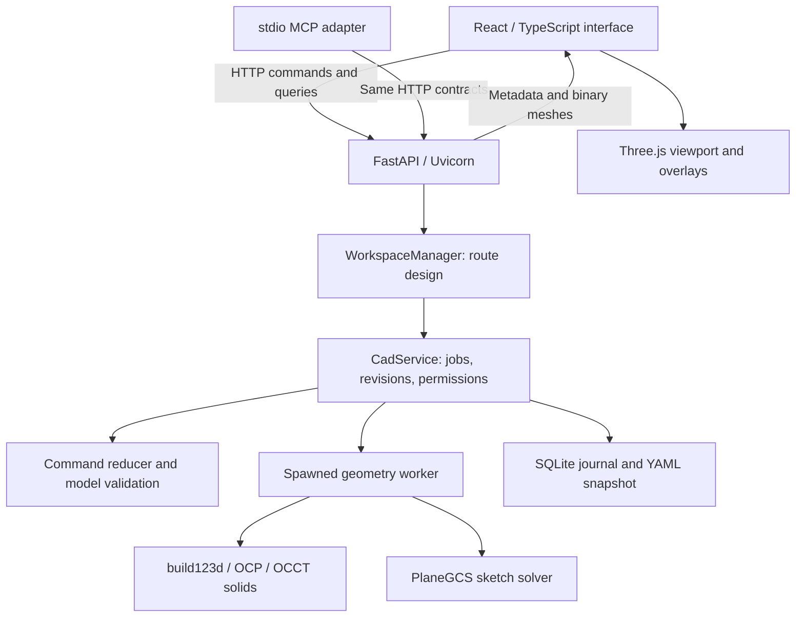

# Architecture

RyanCAD uses a Python application server with a replaceable browser client. Node is a **build/test dependency**, not the production server. See [engine contracts](../product/ENGINE.md) for behavior and [development](DEVELOPMENT.md) for commands.

## Stack and boundaries

| Choice | Purpose |
|---|---|
| Python + Pydantic | Typed intent, validation, commands; domain logic outside React |
| build123d / OCCT | Exact solid modeling and tessellation; not a custom Boolean kernel |
| PlaneGCS | Native sketch constraint solving |
| FastAPI + stdio MCP bridge | Shared service for humans and external agents |
| SQLite + YAML | Durable transactions/history plus readable snapshots |
| React + TypeScript + Three.js | Interactive panels, draft workflows, GPU rendering |
| Vite + pnpm | Build static assets, bundled into the Python wheel |

Versions are pinned in [pyproject.toml](../../pyproject.toml), [uv.lock](../../uv.lock), and [pnpm-lock.yaml](../../frontend/pnpm-lock.yaml). Do not maintain a second version list here. License obligations are in [third-party notices](../../THIRD_PARTY_NOTICES.md).

## Source map

| Area | Main files |
|---|---|
| Startup, networking, tray | `src/ryancad/__main__.py`, `network.py`, `windows_tray.py` |
| HTTP and routing | `api.py`, `workspaces.py`, `projects.py` |
| Document and organization | `model.py`, `project_structure.py`, `structure_scopes.py`, `groups.py`, `placements.py` |
| Transactions and recovery | `service.py`, `commands.py`, `storage.py`, `errors.py` |
| Operation intent and references | `operations.py`, `operation_selection.py`, `reference_snapshots.py`, `feature_edits.py`, `movement.py` |
| Evaluation | `worker.py`, `geometry.py`, `native_runtime.py`, `parameters.py`, `sketches.py` |
| Transfer and libraries | `file_formats.py`, `workspace_folders.py`, `reference_parts.py`, `public_workspace.py`, `defaults/` |
| External agents and reports | `mcp_server.py`, `mcp_setup.py`, `agent_access.py`, `reports.py` |
| UI orchestration and contracts | `frontend/src/App.tsx`, `api.ts`, `types.ts`, `editorContext.ts` |
| Project tree and inspectors | `ProjectStructure.tsx`, `WorkspaceDesignTree.tsx`, `DesignOverview.tsx`, `PartOverview.tsx` |
| Editing panels | `Forms.tsx`, `FeatureEditPanel.tsx`, `MoveComponentPanel.tsx`, `SketchPanel.tsx`, `GroupPanel.tsx` |
| Rendering and guidance | `Viewport.tsx`, `*Guide.tsx`, `viewportHighlights.ts`, `viewportOperationDisplay.ts`, `*Model.ts` helpers |
| Layout and preferences | `OverflowToolbar.tsx`, `toolbarOverflow.ts`, `ToolbarSettings.tsx`, `style.css`, `mobile.css`, `themes.css` |

Backend filenames in the table are relative to `src/ryancad/`; UI filenames to `frontend/src/`.

## Important implementation details

- **One service per open design.** Workspace routing selects it; stale revisions prevent accidental overwrites between clients. This is not real-time collaborative merge.
- **Candidate-first edits.** Reducers modify a candidate document; validation and native evaluation happen before durable acceptance. Preview/commit uses the same path.
- **Isolated native work.** The persistent spawned worker imports the kernel. Hard cancellation terminates it; a subsequent job starts a new worker. Native failures do not become partial saved edits.
- **Derived geometry.** Cache keys/reuse reduce rebuild work. Binary tessellation serves display; exact solids remain worker results. Never infer authoritative dimensions from a browser mesh.
- **Client drafts.** Panels hold unsaved configuration, coalesce preview requests, and discard stale responses. Selection, hover, tool references, and active editor are distinct states.
- **Guidance as a service.** Measurement candidates are scored for relevance and clutter. Labels and reference overlays are presentation logic, separate from geometric truth.
- **Rendering lifecycle.** Keep scene/camera/renderer alive across layout resizes; avoid rebuilding geometry or WebGL contexts for panel changes. Dispose replaced GPU resources.
- **Shared default data.** Public designs are ordinary persistent workspace designs, seeded once from packaged YAML. There is no separate runtime recipe provider.

Current limitations and release work belong in the [beta checklist](BETA.md), not in chronological notes appended to this document.
