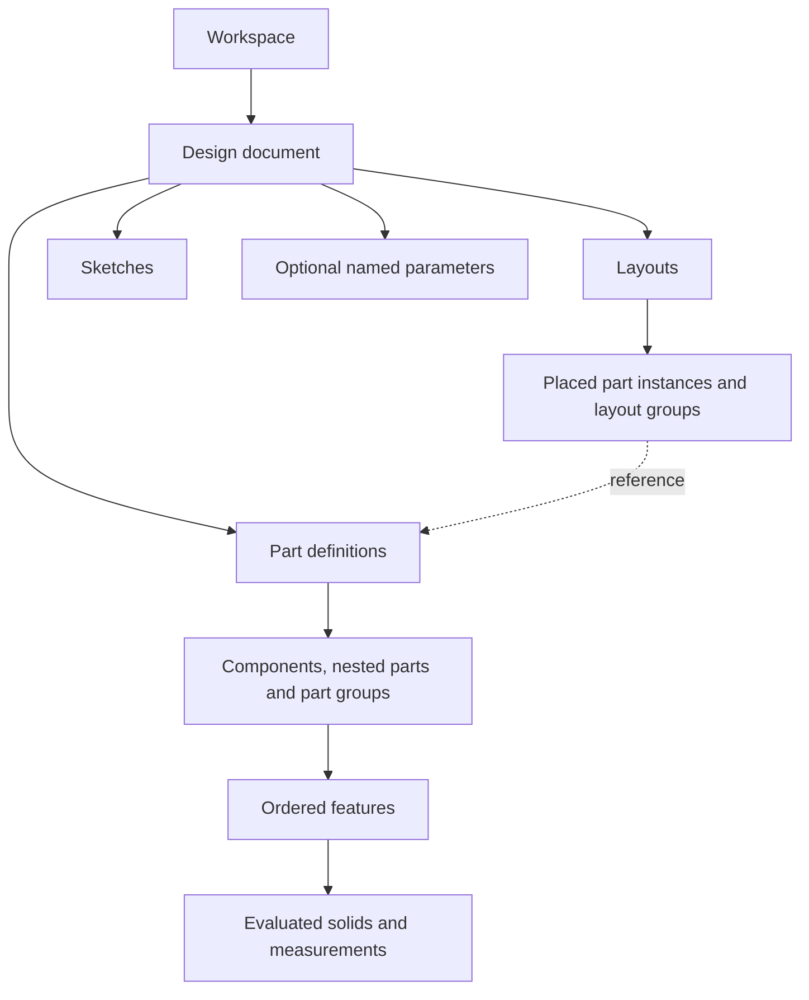
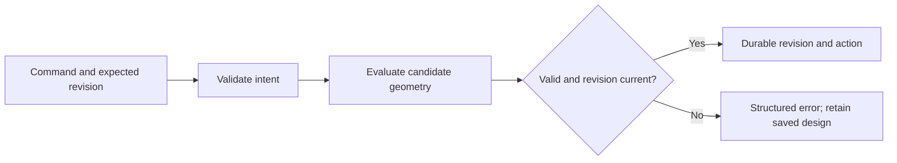

# Engine and API

This guide describes RyanCAD's behavior independently of its interface. For implementation details, see [architecture](../development/ARCHITECTURE.md).

## Document model



| Record | Contract |
|---|---|
| Workspace | Independent design collection; browser ownership and recovery code are server metadata, outside each design document |
| Design | Versioned intent: definitions, instances, features, parameters, variations, authors, descriptions, units |
| Definition | A component, part, group, layout, or tool body, identified by stable ID |
| Instance | Reference to a definition plus placement, visibility, and optional variation; copies can share one definition |
| Feature | Ordered geometry operation with values, options, saved references, and authorship |
| Geometry | Derived solids, topology, meshes, bounds, and statistics; meshes are not the authoritative design |

- Every design has at least one layout. Layouts contain parts/groups; parts contain components, nested parts, and part groups.
- A manufactured component represents one connected solid. Separate bodies require separate components.
- Design names are unique within a workspace; part names are unique within a design. Component names may repeat.
- Tool bodies are reusable modeling geometry, excluded from normal manufactured-part quantities.
- Reference parts are immutable snapshots. Customizing one creates an independent custom part; source edits do not propagate.
- Variations share part features and override selected named parameters.

The current document schema is **0.2**, distinct from the application version. YAML stores intent, not an exact serialized OCCT solid.

## Values and references

| Input | Persistence |
|---|---|
| Ordinary numeric dimension | Local to its operation; not automatically a public named parameter |
| Explicit named parameter | Reusable expression; dependent dimensions reevaluate when it changes |
| Origin, path, profile, or projection from another object | Resolved/copied for the accepted operation; no ongoing cross-component attachment |
| Sketch dimension or relationship | Persistent within that sketch; solved during editing and validated on acceptance |

Internal lengths use **mm**, angles **degrees**. Display units support mm/in. Expressions support named values, arithmetic, approved functions, and units such as `mm`, `cm`, `m`, `in`, `ft`, `deg`, and `rad`. For example, `[Wall thickness] + 0.2 mm` references an exact parameter name. Arbitrary Python execution is not supported. Dimensional validity and dependency cycles are checked.

Cross-component fit constraints are disabled. Geometric topology references inside a component can still become invalid after upstream edits; those failures must be repaired or the edit cancelled.

## Operations and transactions

A unified operation describes **effect + profile + motion/path + origin + extent**. Profiles include basic shapes, faces, sketches, bodies, and generated corner sections. Motions include straight travel, sweep, revolve, helix, and stationary Boolean operations, subject to supported combinations.

- Effects: create, automatic add/cut, add, cut, intersect.
- Extent: distance, finite-path percentage, projected target, or full finite path; reverse is independent of effect.
- Connected path selections belong to one component occurrence. Multiple profiles must satisfy the operation's plane requirements.
- Unsupported combinations and invalid/disconnected solids fail without committing.



Previews do not save. A preview token belongs to its actor and base revision, expires after 15 minutes, and is checked again at commit. A successful mutation means its revision is durable. A queued/running job is not completion.

Accepted revisions retain authorship and request IDs. Identical retries can reuse a request ID; reusing it with changed arguments is rejected. Atomic batches contain 1–100 commands, with no nested batches. Undo/redo and checkpoint restoration create new revisions. Historical feature edits retain identity/order and validate downstream geometry; they do not currently support arbitrary replacement of saved profile/path references.

## Persistence and transfer

| Data | Authority / purpose |
|---|---|
| `journal.sqlite3` | Durable revisions, actions, checkpoints, retry results |
| `manifest.yaml` | Human-readable current snapshot; refreshed after a short quiet period or bounded delay during sustained edits |
| `.rycad.zip` | Portable native design with history |
| YAML export | Current intent only |
| STL | Tessellated solid transfer; no parameters or history |
| SVG | Fabrication sketch geometry in its plane coordinates |

Journal commits precede success responses. Snapshot writes are atomic; external manifest changes are detected rather than silently overwritten. Use native archives or a [complete backup](HOSTING.md#backups-and-recovery), not a live edit of the snapshot.

Current transfer limits:

- STL import: one closed, consistently wound solid; **1–5,000 facets**, interpreted in mm. Facets remain faceted geometry.
- SVG import: up to **200 sketch entities**. Lines/circles retain their form; other supported paths are approximated. Text, images, scripts, external references, and illustration effects are unsupported; convert text/shapes to paths first.
- SVG export: non-construction sketch lines/arcs/circles; no automatic kerf compensation or 3D silhouette extraction.
- Workspace folders: one-time transfer of designs, histories, and exports; no automatic synchronization or browser preferences.

## HTTP contracts

The Python service exposes `/api`. Browser clients use session cookies; external clients use the server bearer token. `X-RyanCAD-Workspace` and `X-RyanCAD-Design` select a target; mutations identify a registered actor through `X-RyanCAD-Actor`.

| Endpoint family | Purpose |
|---|---|
| `GET /health`, `/capabilities` | Availability; command descriptions, fields, operation JSON schema, units, limits, document ID/revision |
| `GET /state`, `/geometry/{id}` | Intent and evaluated metadata; separate binary display geometry |
| `POST /commands` | `{name, args, expected_revision, request_id}` → job/result |
| `POST /previews`, `/previews/{token}/commit` | Evaluate without saving; accept a validated candidate |
| `GET /jobs/{id}`, `POST /jobs/{id}/cancel` | Completion, failure, cancellation |
| `/events`, `/activity`, `/history/{id}` | Poll changes, inspect authorship, evaluate build stages |
| `/workspace`, `/workspaces`, `/workspace/designs` | Workspace/design lifecycle, naming, selection, recovery |
| `/design-library`, `/reference-parts` | Browse, preview, open/import designs and reference definitions |
| `/import-geometry/{stl\|svg}`, `/export`, `/export-svg`, `/native`, `/manifest` | File transfer |
| `/agents`, `/workspace/agents/status` | Agent sessions and server-wide access switch |
| `/reports` | Shared report CRUD and screenshots, outside individual workspaces |

Paths in the table omit `/api`. The command catalog covers structure, placement/movement, features, sketches, parameters, history, and exports. Read **live capabilities** for exact supported arguments rather than guessing from UI labels. Some low-level commands remain available without a toolbar entry. Errors include a code and explanation; stale revisions require rereading state before retrying.

Current guardrails include **250 definitions, 2,000 features, 200 entities per sketch, and 10,000 mm per-part span/absolute local-coordinate limits**. Most HTTP requests have an 8 MB limit; workspace folder transfer has separate limits. These are application limits, not promised performance targets.

## External agents (MCP)

```text
Agent harness ↔ stdio MCP adapter ↔ authenticated HTTP ↔ same design service
Browser observes the same revisions, actions, previews, and authors
```

Run the server first. Configure the harness to launch its virtual-environment Python with:

```text
-m ryancad.mcp_server --connection /absolute/path/to/runtime/connection.json --name "CAD agent"
```

The connection file supplies the local URL/token. Do not share it as public configuration. Workspace/design arguments are optional: the adapter discovers open browser targets, selects a sole target, or requests an explicit selection when ambiguous. It stays pinned for its lifetime. Reconnect to change an already-used target.

| MCP tool | Returns / action |
|---|---|
| `cad_sessions`, `cad_select_session` | Discover and select a browser target |
| `cad_capabilities` | Current command catalog, schemas, units, limits, document ID/revision |
| `cad_inspect` | Document, dimensions, dependencies, geometry metadata, recent activity; optional component filter |
| `cad_preview`, `cad_commit_preview` | Validate a proposed semantic command; commit its token |
| `cad_execute` | Submit one authored command with expected revision and optional retry ID |
| `cad_job`, `cad_cancel` | Follow/cancel work |
| `cad_measure` | Distance/intersection between placed component occurrences |
| `cad_export_stl` | Validated files and revision receipt |

Agents receive **structured design data, not viewport images or mouse access**. There is no built-in chat/model provider. Tool discovery alone does not create a connected agent; the first CAD request registers a session, maintained by heartbeat and expired after disconnection. Pause/revoke controls and the server-wide access switch are enforced by the service. Disabling MCP leaves normal browser modeling available.
